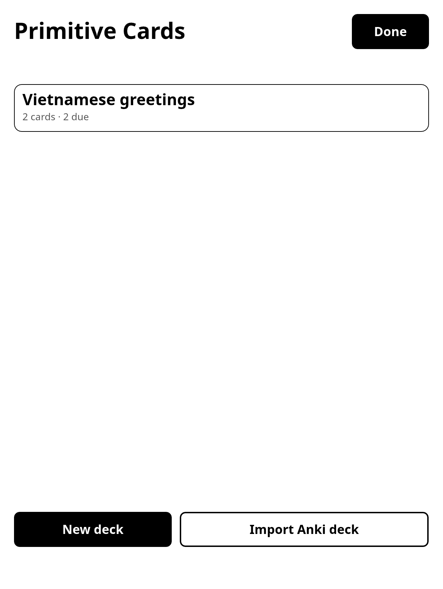
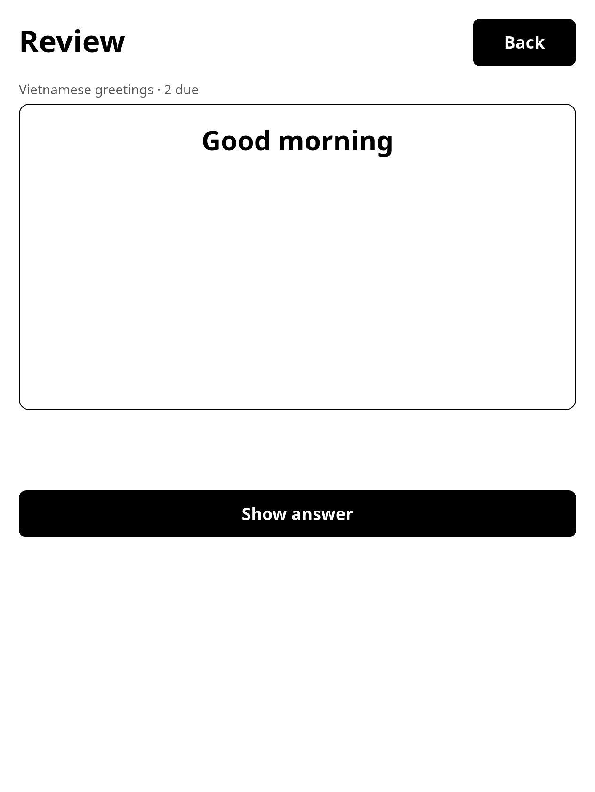
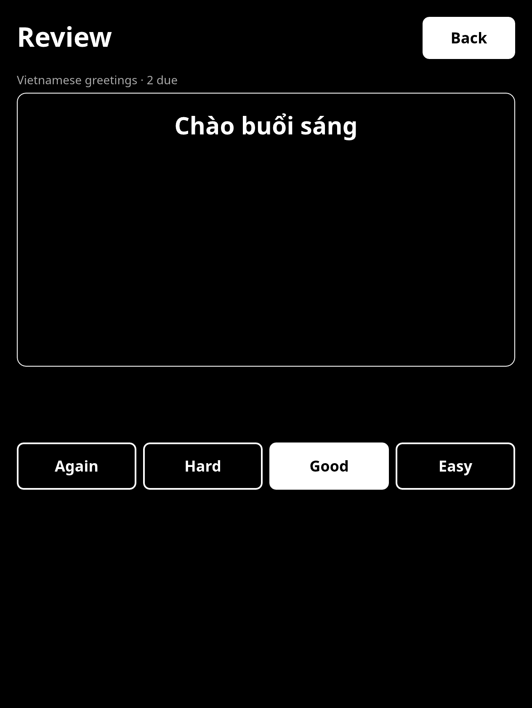

<div align="center">

# Cards

**Text flashcards with spaced repetition for Kindle e-readers.**

[Install guide](INSTALL.md) · [Device notes](docs/device-notes.md) · [Changelog](CHANGELOG.md)

</div>

---

Create decks and cards with the Kindle keyboard, review cards when they are due, and track recall by deck. Import
text decks from Anki or export your own cards to Documents.

## Screenshots

<table>
  <tr>
    <td align="center"><br><sub>Decks and cards due</sub></td>
    <td align="center"><br><sub>A review question</sub></td>
    <td align="center"><br><sub>Answer and recall choices</sub></td>
  </tr>
</table>

<sub>Desktop simulation at 1264 × 1680 with a sample vocabulary deck.</sub>

## Highlights

- Organize text cards into decks, track due counts and recall, and page through long card text.
- Four recall choices follow SuperMemo SM-2, with one-day rescheduling after a miss. [SuperMemo method](https://www.supermemo.com/en/supermemo-method)
- Import the first two text fields from an Anki `.apkg` in Documents. Both legacy SQLite and modern compressed
  collections are supported. Text imports omit media, custom templates, and prior review schedules.
- Export a deck as tab-separated UTF-8 text in Documents.

## Quick start

Copy the `cards` and `documents` folders from the local ARMHF package to your Kindle over USB, then eject and open
**Cards** from Primitive Launcher. The app uses the fonts installed by Launcher. [Install guide](INSTALL.md)

## Status

Desktop simulation and local ARMHF package checks passed on the Mac.
On an ARMHF Kindle Oasis 3 running firmware 5.18.2, Cards showed the Anki import instructions, returned to the
original deck library with Back, and exited to Launcher.
[Device notes](docs/device-notes.md)

## Develop locally

Keep `doannt-kindle-tools` and `doannt-kindle-launcher` next to this checkout. The desktop command writes sample PNGs
to `build/previews`. The Kindle and desktop drivers share the same card state and scheduling logic.

```sh
cargo test --offline --locked --workspace
cargo run --offline --locked -p cards-desktop -- build/previews
```

## Licence

Copyright (C) 2026 Doan Nguyen.

App code is licensed under PolyForm Noncommercial 1.0.0. [Code license](LICENSE)

Original documentation and screenshots are licensed under Creative Commons Attribution-NonCommercial-ShareAlike 4.0
International (CC BY-NC-SA 4.0). [Documentation and image license](LICENSE-DOCS)
